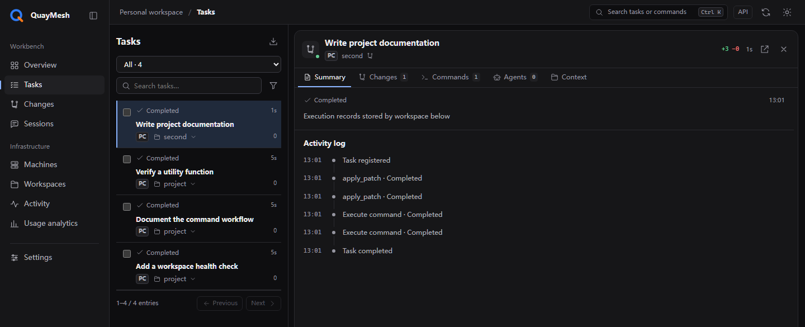
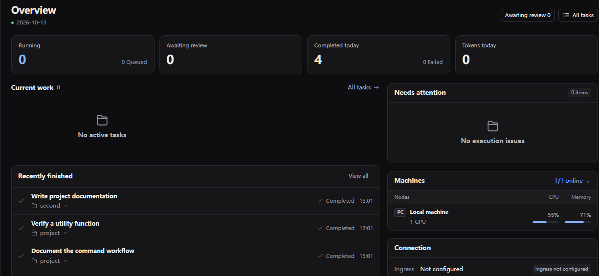
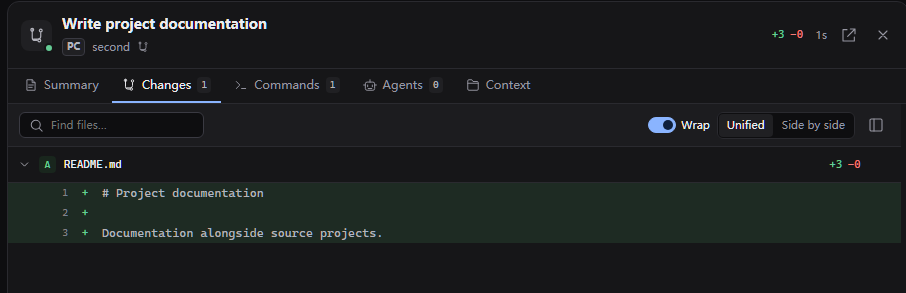
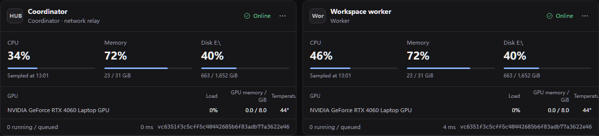
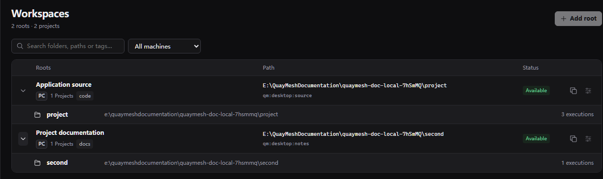
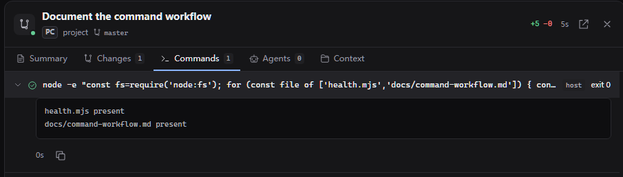
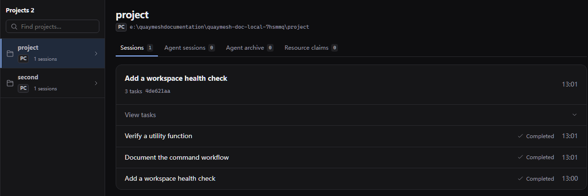
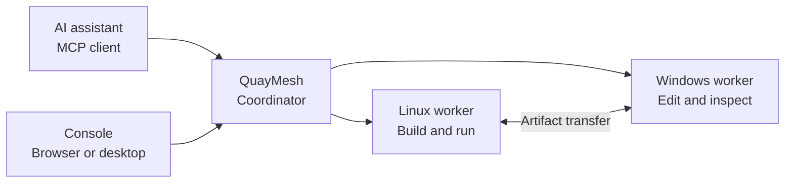

<p align="center">
  
</p>

<h1 align="center">QuayMesh</h1>

<p align="center"><strong>One conversation. Work across your machines.</strong></p>

<p align="center">
  English · <a href="README.zh-CN.md">简体中文</a><br>
  <a href="https://github.com/ershiyidian/QuayMesh/releases/latest">Download</a> ·
  <a href="docs/INSTALL.md">Get started</a> ·
  <a href="docs/ARCHITECTURE.md">Architecture</a> ·
  <a href="CONTRIBUTING.md">Contribute</a>
</p>

QuayMesh connects AI assistants to workspaces on Windows and Linux through the Model Context Protocol (MCP). From one conversation, you can edit files, run commands, delegate work to coding agents, and follow the results across machines.

A task keeps its workspaces, command output, file changes, and agent threads together. The browser console and Windows desktop app give you the same view of that work.

<a href="docs/assets/screenshots/en/task-detail.png">
  
</a>

<p align="center"><sub>One task, one place to review its operations and results.</sub></p>

## Explore the console

### Your work at a glance

Follow active tasks, recent results, and machine activity in one view.

[](docs/assets/screenshots/en/overview.png)

### Inspect the exact changes

Open the saved code diff for any task, down to individual lines.

[](docs/assets/screenshots/en/changes.png)

### Keep your machines connected

See the coordinator and workers together, including their status and resource usage.

[](docs/assets/screenshots/en/fleet.png)

### Find projects across workspaces

Browse the project directories each node makes available.

[](docs/assets/screenshots/en/workspaces.png)

<details>
<summary><strong>More views: command output and conversation history</strong></summary>

#### Saved command output

Reopen the commands executed for a task and read their retained output.

[](docs/assets/screenshots/en/commands.png)

#### Conversations and tasks

Follow multiple tasks from the same conversation.

[](docs/assets/screenshots/en/sessions.png)

</details>

## What you can do

**Reach every workspace through one connection.** Discover projects across your nodes and open them where they live. Files and processes stay on their owning machine.

**Keep long-running work accessible.** Commands return an operation ID. Read their retained output, send input, or cancel a specific process as the task continues.

**Work with coding agents.** Start an agent, continue its existing thread, or send guidance while it runs. Each node advertises the providers available on that machine.

**Move files between machines.** Transfer artifacts directly between workers and inspect progress through the same task. Chat attachments can be imported into a workspace.

**Follow the complete task.** Each user request gets a task within its conversation. Saved output, file differences, and checkpoints make it straightforward to resume work.

**Choose how your nodes connect.** Use the bundled EasyTier network, an existing network, or local-only operation. Multiple discovery nodes can serve the same OpenAI tunnel.

## Get started

Download and extract the package for your operating system. Each package includes Node.js, the QuayMesh application, and its platform components.

| Platform | Package |
| --- | --- |
| Windows x64 | [QuayMesh-v0.1.0-windows-x64.zip](https://github.com/ershiyidian/QuayMesh/releases/download/v0.1.0/QuayMesh-v0.1.0-windows-x64.zip) |
| Linux x64 | [QuayMesh-v0.1.0-linux-x64.zip](https://github.com/ershiyidian/QuayMesh/releases/download/v0.1.0/QuayMesh-v0.1.0-linux-x64.zip) |

Start a local node from the extracted directory:

<details open>
<summary><strong>Linux</strong></summary>

```bash
mkdir -p ~/quaymesh-projects
./runtime/node bin/quaymesh.js init-site --directory ./site --inventory ./examples/local.json
./runtime/node bin/quaymesh.js run --config ./site/local.json
```

</details>

<details>
<summary><strong>Windows PowerShell</strong></summary>

```powershell
New-Item -ItemType Directory -Force "$HOME\quaymesh-projects"
.\runtime\node.exe .\bin\quaymesh.js init-site --directory .\site --inventory .\examples\local.json
.\runtime\node.exe .\bin\quaymesh.js run --config .\site\local.json
```

</details>

Open **http://127.0.0.1:17676/console/** and sign in with the `QUAYMESH_OWNER_TOKEN` generated in `site/secrets.local.env`. This example exposes `~/quaymesh-projects` as a workspace.

The [installation guide](docs/INSTALL.md) covers background services, the Windows desktop app, multi-machine setup, and connecting an MCP client.

## A task across machines

Ask your assistant to build a project on a Linux worker, inspect its logs, and copy the resulting package to a Windows workspace. QuayMesh keeps those operations under one task, with each operation linked to its machine and output.



A node can combine several roles. The coordinator provides the shared connection and task directory; workers operate on local projects. Discovery and network-exit capabilities can be enabled where needed.

## Built for ongoing work

QuayMesh records a command's progress independently of the response that started it. Output remains addressable by its operation ID, and retries can reuse the original request key.

File updates carry their affected paths. Task snapshots use those paths for incremental collection, while general commands collect workspace changes. Git worktrees provide separate checkouts for parallel development, and resource coordination tracks overlapping writes.

Read more about [tasks and agents](docs/TASKS.md), [file changes and concurrency](docs/execution-resources.md), and [the console](docs/console.md).

## Documentation

| Guide | Contents |
| --- | --- |
| [Installation](docs/INSTALL.md) | Local setup, services, multiple machines, MCP connections |
| [Configuration](docs/CONFIGURATION.md) | Node capabilities, project roots, networking, storage |
| [Tasks and agents](docs/TASKS.md) | Commands, artifacts, checkpoints, agent threads |
| [Architecture](docs/ARCHITECTURE.md) | Components, data ownership, request flow |
| [Development](CONTRIBUTING.md) | Source builds, project layout, contributions |

## License and acknowledgements

QuayMesh is licensed under [MIT](LICENSE). It builds on [DevSpace](https://github.com/Waishnav/devspace) and includes adaptations from OpenAI Codex and Pi.

EasyTier and OpenAI tunnel-client provide the bundled network components. Their source archives and licenses are included under `third_party/`. See [NOTICE](NOTICE) and [third-party notices](THIRD_PARTY_NOTICES.md) for attribution and component licenses.
