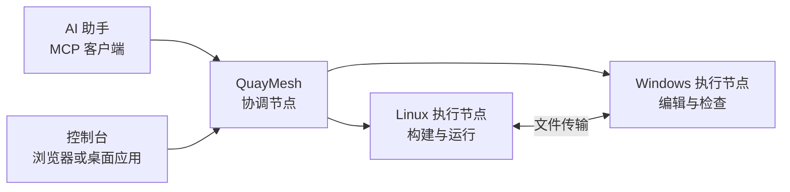

<p align="center">
  
</p>

<h1 align="center">QuayMesh</h1>

<p align="center"><strong>在同一个对话中，使用多台机器上的项目。</strong></p>

<p align="center">
  <a href="README.md">English</a> · 简体中文<br>
  <a href="https://github.com/ershiyidian/QuayMesh/releases/latest">下载安装包</a> ·
  <a href="docs/zh-CN/INSTALL.md">开始使用</a> ·
  <a href="docs/zh-CN/ARCHITECTURE.md">项目架构</a> ·
  <a href="docs/zh-CN/CONTRIBUTING.md">参与开发</a>
</p>

QuayMesh 通过 MCP（模型上下文协议），将 AI 助手连接到 Windows 和 Linux 上的工作区。你可以在同一个对话中修改文件、执行命令、调用编程代理，并查看各台机器上的执行结果。

每个任务集中保存工作区、命令输出、文件变更和代理线程。浏览器控制台与 Windows 桌面应用展示同一份任务记录。


## 核心能力

**通过一个连接访问多台机器。** 助手可以发现各个节点上的项目，并在项目所在的机器上打开工作区。文件和进程保留在所属机器上。

**持续查看长时间运行的任务。** 命令返回操作编号后，可以继续读取输出、发送输入或取消指定进程。输出按操作保存，方便稍后查看。

**与编程代理协作。** 启动代理、继续已有线程，或者在执行期间补充要求。每个节点会提供本机可用的代理列表。

**在机器之间传输文件。** 文件可以直接在执行节点之间复制，任务中能够查看传输进度。聊天附件也可以导入工作区。

**保留完整的任务上下文。** 每次用户请求对应一个任务，同一段对话可以包含多个任务。命令输出、文件差异和检查点帮助助手恢复工作。

**灵活组织节点网络。** 可以使用内置 EasyTier、已有网络或单机模式。多个发现节点能够连接同一个 OpenAI 隧道。

## 开始使用

下载并解压对应系统的安装包。包内包含 Node.js、QuayMesh 程序及平台组件。

| 平台 | 安装包 |
| --- | --- |
| Windows x64 | [QuayMesh-v0.1.0-windows-x64.zip](https://github.com/ershiyidian/QuayMesh/releases/download/v0.1.0/QuayMesh-v0.1.0-windows-x64.zip) |
| Linux x64 | [QuayMesh-v0.1.0-linux-x64.zip](https://github.com/ershiyidian/QuayMesh/releases/download/v0.1.0/QuayMesh-v0.1.0-linux-x64.zip) |

在解压目录中启动本地节点：

<details open>
<summary><strong>Windows PowerShell</strong></summary>

```powershell
New-Item -ItemType Directory -Force "$HOME\quaymesh-projects"
.\runtime\node.exe .\bin\quaymesh.js init-site --directory .\site --inventory .\examples\local.json
.\runtime\node.exe .\bin\quaymesh.js run --config .\site\local.json
```

</details>

<details>
<summary><strong>Linux</strong></summary>

```bash
mkdir -p ~/quaymesh-projects
./runtime/node bin/quaymesh.js init-site --directory ./site --inventory ./examples/local.json
./runtime/node bin/quaymesh.js run --config ./site/local.json
```

</details>

打开 **http://127.0.0.1:17676/console/**，使用 `site/secrets.local.env` 中自动生成的 `QUAYMESH_OWNER_TOKEN` 登录。这个示例将 `~/quaymesh-projects` 作为工作区。

[安装指南](docs/zh-CN/INSTALL.md)介绍后台服务、Windows 桌面应用、多机器部署及 MCP 客户端连接方法。

## 一个任务，多台机器

例如，让助手在 Linux 节点构建项目、查看日志，再将生成的安装包复制到 Windows 工作区。这些操作会归入同一个任务，每项操作都保留所属机器与输出记录。



同一个节点可以承担多项职责。协调节点提供统一连接和任务目录，执行节点处理本机项目；发现服务和网络出口可以按需开启。

## 为持续工作而设计

命令执行进度独立于发起命令时的响应保存。后续可以通过操作编号读取结果，重复请求也可以沿用原来的请求标识。

文件修改会携带涉及的路径，任务快照据此增量收集变化；普通命令执行后收集工作区变化。Git 工作树可以提供独立检出目录，资源协调机制负责记录相互重叠的写入操作。

进一步了解[任务与代理](docs/zh-CN/TASKS.md)、[文件变更与并发](docs/zh-CN/execution-resources.md)和[控制台](docs/zh-CN/console.md)。

## 文档

| 指南 | 内容 |
| --- | --- |
| [安装](docs/zh-CN/INSTALL.md) | 单机使用、后台服务、多机器部署、MCP 连接 |
| [配置](docs/zh-CN/CONFIGURATION.md) | 节点能力、项目目录、网络、存储 |
| [任务与代理](docs/zh-CN/TASKS.md) | 命令、文件传输、检查点、代理线程 |
| [架构](docs/zh-CN/ARCHITECTURE.md) | 组件分工、数据归属、请求过程 |
| [参与开发](docs/zh-CN/CONTRIBUTING.md) | 源码构建、目录结构、提交修改 |

## 许可证与致谢

QuayMesh 使用 [MIT 许可证](LICENSE)，基于 [DevSpace](https://github.com/Waishnav/devspace) 开发，并包含对 OpenAI Codex 与 Pi 的适配。

内置网络组件由 EasyTier 和 OpenAI tunnel-client 提供，对应源码包和许可证保存在 `third_party/`。版权来源与组件许可见 [NOTICE](NOTICE) 和[第三方说明](THIRD_PARTY_NOTICES.md)。
