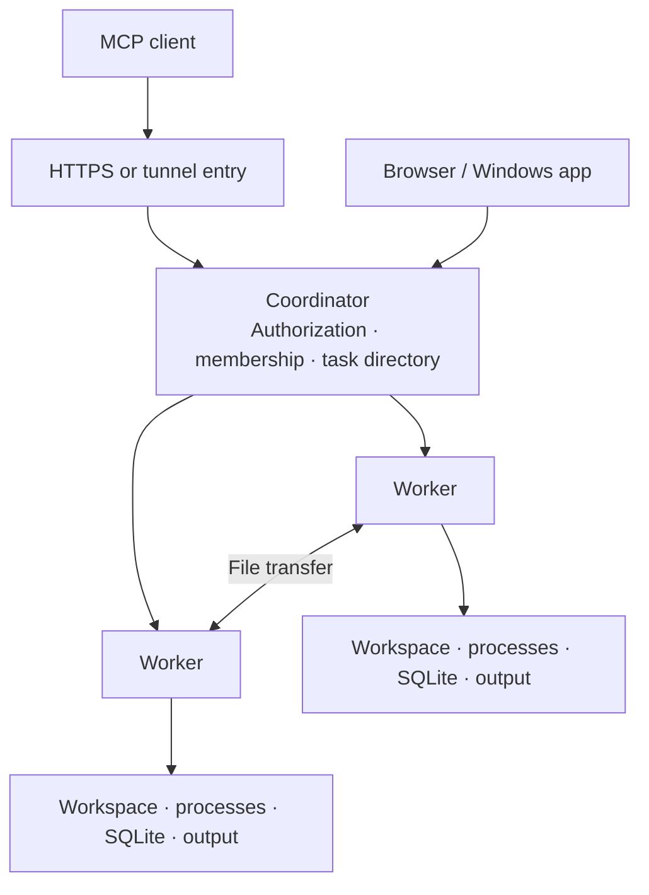

# Architecture

[English](ARCHITECTURE.md) · [简体中文](zh-CN/ARCHITECTURE.md) · [Home](../README.md)

QuayMesh brings remote execution and its history into the same task model. One client connection discovers workspaces across nodes, while each worker manages its own files and processes.

## Components

The node manager in `node/` starts and supervises the configured components. Core in `src/` implements MCP tools, workspace operations, process management, task history, and Console APIs.

Linux runs the manager through systemd. Windows uses the Host application and a scheduled task. Network and discovery components run as separate processes.

## Request flow

A client opens a task and selects a workspace from the node catalog. The workspace handle carries the owning node's identity.

The coordinator forwards workspace operations to that worker. The worker records the operation, prepares the relevant file state, and starts execution. Long operations return a stable identifier while their output continues to accumulate.

The client reads subsequent output by byte cursor. Completion, cancellation, and errors remain associated with the original operation and task.

## Task data

| Object | Meaning |
| --- | --- |
| Session | A conversation containing related requests |
| Task | One user request and its workspaces |
| Operation | One command, file change, transfer, or agent action |
| Run | An execution record associated with the task |
| Checkpoint | A saved summary of decisions and the next action |

The coordinator stores shared entry and authorization state. Workers retain their execution records, output, and file evidence in local SQLite databases and state directories.

Closing a task preserves a task-specific view of its files and results. Later tasks in the same conversation retain their own records.

## File changes

Before the first mutation, the collector records a comparison baseline. Subsequent structured file changes provide affected paths, allowing incremental snapshots. General commands collect the workspace because their effects can span multiple files.

Git snapshots use a separate index. Existing staged changes remain in the user's index. File ownership records support restoring eligible changes while checking the file's current contents.

Resource coordination handles overlapping operations. Independent project scopes can execute concurrently; Git worktrees provide separate checkouts when the work requires isolation.

## Connectivity

EasyTier supplies the optional node network. QuayMesh can also operate over existing network addresses. Worker communication uses HTTP/2.

Discovery nodes forward an OpenAI tunnel to the same coordinator. A local relay supplies a stable MCP and Console entry on each configured node.

Network-exit selection considers node availability, configured priorities, and proxy health. Each established connection keeps the exit chosen when it was created.

## Source map

| Directory | Responsibility |
| --- | --- |
| `node/` | Configuration, components, installation, node discovery |
| `src/session/` | Sessions, tasks, checkpoints, file history |
| `src/federation/` | Cross-node requests and artifact transfer |
| `src/ui/` | Browser console and chat task card |
| `apps/windows/` | Windows Host and shared desktop components |
| `apps/native/windows/` | Windows WebView2 window |
| `schema/` | Configuration and database definitions |
| `third_party/` | Bundled component sources and licenses |

See [tasks](TASKS.md), [configuration](CONFIGURATION.md), and [development](../CONTRIBUTING.md) for implementation and usage details.
