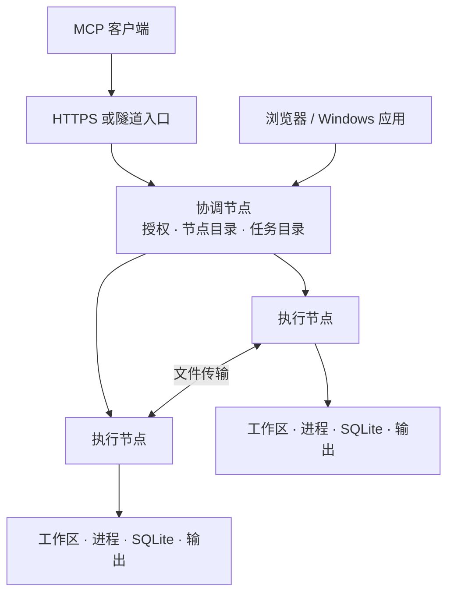

# 架构

[English](../ARCHITECTURE.md) · 简体中文 · [首页](../../README.zh-CN.md)

QuayMesh 将远程执行与执行记录组织在同一套任务结构中。一个客户端连接可以发现各个节点的工作区，每个执行节点负责自己的文件和进程。

## 组件分工

`node/` 中的节点管理器负责启动和管理配置中的组件。`src/` 中的核心服务提供 MCP 工具、工作区操作、进程管理、任务记录和控制台接口。

Linux 通过 systemd 运行节点管理器。Windows 使用 Host（宿主程序）和计划任务。网络与发现组件拥有各自的独立进程。

## 请求过程

客户端创建任务，再从节点目录中选择工作区。工作区标识包含所属节点的信息。

协调节点将操作转发给对应执行节点。执行节点记录操作、准备相关文件状态，并开始执行。耗时操作返回稳定的操作编号，输出继续保存。

客户端通过字节位置继续读取输出。完成、取消和错误结果都归属于原来的操作与任务。

## 任务数据

| 对象 | 含义 |
| --- | --- |
| Session（会话） | 包含多个相关请求的一段对话 |
| Task（任务） | 一次用户请求及其工作区 |
| Operation（操作） | 一次命令、文件修改、传输或代理动作 |
| Run（执行记录） | 任务相关的具体执行过程 |
| Checkpoint（检查点） | 已保存的判断与下一步操作 |

协调节点保存统一入口和授权状态。各执行节点在本机 SQLite 数据库及状态目录中保存执行记录、输出和文件变更资料。

任务结束后，保留该任务对应的文件与结果记录。同一会话中的后续任务拥有各自的记录。

## 文件变化

第一次修改前，收集器保存用于比较的基准。之后，结构化文件操作提供涉及的路径，快照据此增量更新。普通命令可能修改多个文件，因此会收集整个工作区的变化。

Git 快照使用独立索引，用户已经暂存的修改继续保留在自己的索引中。文件归属记录支持恢复符合条件的修改，恢复时会检查文件的当前内容。

资源协调机制负责处理相互重叠的操作。独立项目范围可以并行执行；需要独立代码目录时，可以使用 Git 工作树。

## 网络连接

EasyTier 提供可选的节点网络，也可以使用已有网络地址。执行节点之间通过 HTTP/2 通信。

发现节点将 OpenAI 隧道转发到同一个协调节点。本地中转服务为配置的节点提供固定的 MCP 和控制台入口。

网络出口根据节点在线状态、配置优先级和代理健康状态选择。每条已经建立的连接继续使用原出口。

## 源码目录

| 目录 | 职责 |
| --- | --- |
| `node/` | 配置、组件、安装、节点发现 |
| `src/session/` | 会话、任务、检查点、文件历史 |
| `src/federation/` | 跨节点请求和文件传输 |
| `src/ui/` | 浏览器控制台和聊天任务卡片 |
| `apps/windows/` | Windows 宿主和共享桌面组件 |
| `apps/native/windows/` | Windows WebView2 窗口 |
| `schema/` | 配置和数据库定义 |
| `third_party/` | 内置组件源码和许可证 |

具体使用方法见[任务](TASKS.md)、[配置](CONFIGURATION.md)和[开发说明](CONTRIBUTING.md)。
