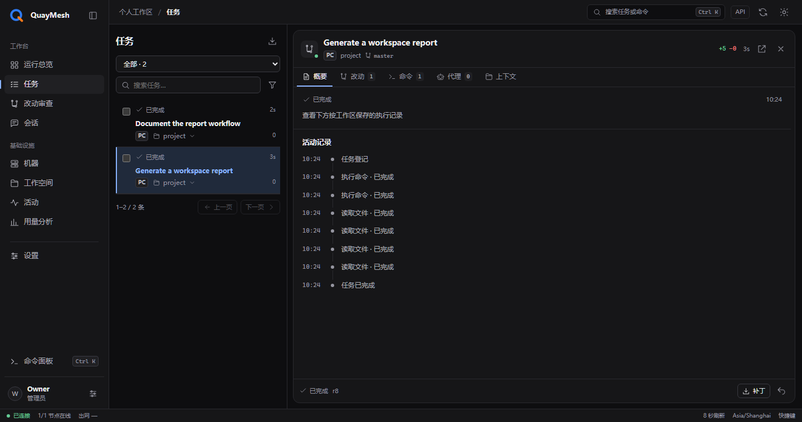
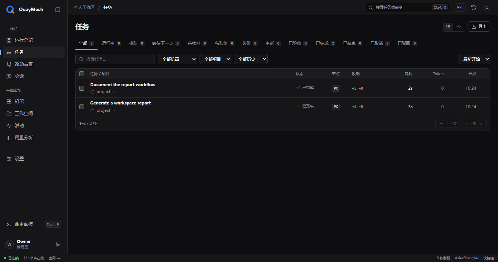

# 控制台

[English](../console.md) · 简体中文 · [首页](../../README.zh-CN.md)

控制台集中展示任务、工作区、命令和编程代理，可以通过浏览器或 Windows 桌面应用打开。

## 查找工作

总览显示当前工作和最近任务，任务列表提供完整历史及状态筛选。展开任务后，可以查看对应工作区、命令、输出和文件变化。

工作区详情包含所属节点、项目和路径。会话页面组织相关任务，代理页面展示代理线程及其执行状态。

## 查看执行过程

命令输出与生成它的操作一起保存。同一个任务可以包含多台机器上的操作，各项操作分别保留状态和结果。

文件差异归属于对应任务。已经结束的任务仍保留当时记录的文件和输出，方便回看。

### 理解任务状态

一次请求、后台执行和验收分别保留状态。完成一条命令或一个工作区阶段，不会自动关闭请求。请求也可以已经交接，同时仍有后台执行。详情会同时保留交付结果与当前执行状态。

“当前无后台执行”表示没有确认活跃的命令或代理，不推断用户需要输入。最后一次执行失败或停止后，在后续工作接续前保留明确提示。未解决的副作用和过期观察继续出现在待处理入口，包括旧阶段及已关闭请求中的记录。交付确认失败时显示已经保存的原因。

通过“结束请求”记录交付结果，接受和驳回结果使用独立验收动作。结束前需要确认任务相关成员没有活跃或未决执行。与该任务无关的离线节点不会阻挡其操作。

### 文件证据与采集状态

文件列表为空，也可能是改动仍在采集或采集失败。“改动”页会逐个显示相关工作区的采集状态、节点、完整路径和已记录的错误，已经取得的文件仍可查看。采集中或采集失败时，页面明确说明证据尚不完整，不会显示成“没有改动”。

所选实时范围的采集尚未结束或已经失败时，暂不能接受或驳回验收、导出补丁、还原文件。请核对并处理采集错误，或等待当前采集结束，再刷新文件证据。服务端也会核验采集状态和证据版本。撤销预览或分页导出补丁期间，证据发生变化时需要刷新并重新开始，以保证操作针对同一份已经查看过的版本。

没有采集提示，只说明当前服务未观察到正在进行或失败的采集，不证明所有文件变化已经归档。已经冻结的历史检查点保留自身证据；后续任务即使在同一工作区采集中，也不会阻挡查看或导出之前的检查点。旧节点没有提供采集状态字段时，页面不会仅因字段缺失而判为采集失败。

### 控制操作与回执

停止操作覆盖相关阶段中的受管命令和代理。批量操作逐一保留目标结果，显示部分成功和不可达节点。派发前保存原始目标清单及请求标识；响应丢失后，可以在操作回执中核对原请求，已成功目标不会被重复执行。

回执区分没有生效、已经生效、部分生效和结果未知。“停止请求已接收”不推断进程已经退出。写入结果未知时，表单保留原提交内容用于核对；确认没有副作用的拒绝，可以修改内容并使用新请求标识提交。

### 历史、配置和用量

会话可以跨项目、跨节点搜索，尚无执行阶段的请求也能打开。多工作区任务的文件标明所属阶段，并提供进入具体阶段的入口，用于导出该工作区补丁或还原文件。任务分页最多保留十五分钟的固定排列顺序；缓存容量限制或服务重启可能使其提前过期，页面会提示返回第一页。刷新第一页后纳入新增任务和最新排序。

配置表单读取持久配置及其版本，包括已经保存、等待应用的更改。刷新时比较原始值、本地编辑和最新保存值；冲突字段需要明确选择。已保存版本、已应用版本、待应用状态和应用失败原因分别展示。

用量按代理执行轮次的结束日期统计，并使用所选时区。运行中的轮次和缺少结束时间的记录单独列出。统计下钻保留贡献轮次的日期范围；任务排名先合并所有阶段，再选出用量最多的任务。导出包含筛选、时区及来源覆盖范围。

## 登录

使用创建站点时生成的所有者密码。控制台会话可以在后续打开浏览器时继续使用，Windows 应用通过当前用户的加密存储保存会话。

账户设置支持退出当前设备，也支持撤销其他设备上的会话。

## 桌面应用

安装前，在 Windows 节点中启用 `desktopUi`。桌面应用通过节点的本地入口打开同一控制台，并使用一致的深浅色主题。

托盘、宿主程序、浏览器图标和桌面窗口使用项目中的 `app.ico`。

## 连接状态

控制台显示节点连接状态及数据更新时间。获取新数据期间，页面继续展示之前收到的数据。

各项资源独立刷新。页面隐藏或失去网络时取消不必要的读取，返回后恢复。活跃观察过期后显示待核对，耗时停在最后一次确认时间。已经确认的数量与缺失来源分别表达。诊断面板可以查看资源耗时、版本和来源状态，并导出排障记录。

失败通知为每个节点单独保存事件游标。节点不可达时保留其进度，恢复后补读事件，通知范围不再依赖总览中的少量样本。

排查连接问题时，可以查看节点状态和组件日志，命令见[安装指南](INSTALL.md)。

## 任务记录

